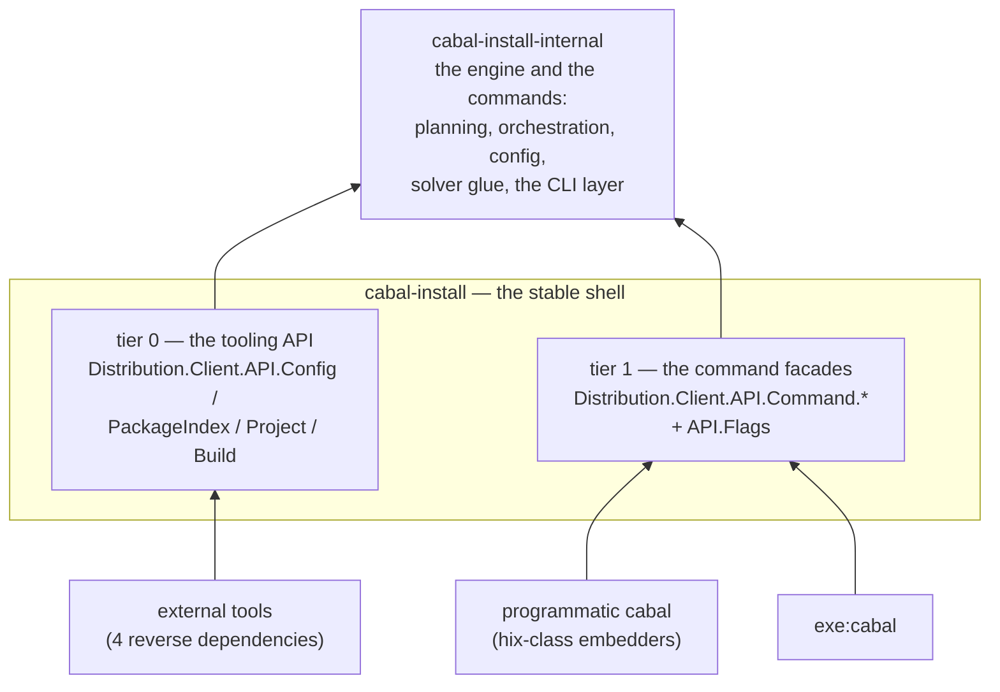
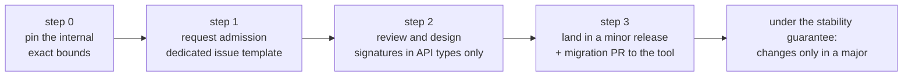
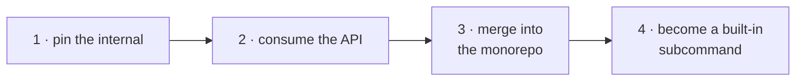
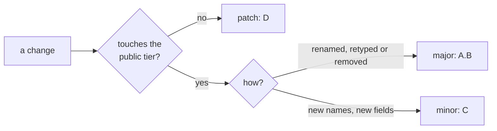

# Formalize a stable public API tier for cabal-install

I would like to present my research on this topic to the Cabal developers and the community

## Contents

- [Summary](#summary)
- [Motivation](#motivation)
  - [Backports become a mechanical decision](#backports-become-a-mechanical-decision)
  - [API consumers get releases in days, not months](#api-consumers-get-releases-in-days-not-months)
  - [Supporting every consumer is now affordable — and automatable](#supporting-every-consumer-is-now-affordable--and-automatable)
- [Current situation](#current-situation)
  - [Hackage package status](#hackage-package-status)
  - [Usage depth summary](#usage-depth-summary)
  - [Seed table: closure and consumers](#seed-table-closure-and-consumers)
- [Separating active and abandoned packages](#separating-active-and-abandoned-packages)
  - [Sensitivity of the closure to the set of rdeps](#sensitivity-of-the-closure-to-the-set-of-rdeps)
  - [Stable API core: 19 modules](#stable-api-core-19-modules)
    - [User configuration (base layer)](#user-configuration-base-layer)
    - [Package index](#package-index)
    - [Project and Layout](#project-and-layout)
    - [Build Orchestration (10 modules — the "blob" core)](#build-orchestration-10-modules--the-blob-core)
    - [Infrastructure](#infrastructure)
    - [Legacy](#legacy)
- [Proposed Change](#proposed-change)
  - [Target design: two packages, two stability tiers](#target-design-two-packages-two-stability-tiers)
  - [New public modules](#new-public-modules)
  - [Diagram: Who Needs What](#diagram-who-needs-what)
  - [Design Principles](#design-principles)
  - [API admission process](#api-admission-process)
  - [Commands are residents, not consumers](#commands-are-residents-not-consumers)
  - [The graduation ladder](#the-graduation-ladder)
- [Migrating reverse dependencies to the new API](#migrating-reverse-dependencies-to-the-new-api)
  - [Replacing internal imports with the API](#replacing-internal-imports-with-the-api)
  - [Scope of changes by package](#scope-of-changes-by-package)
  - [Independent breaking changes in Cabal/cabal-install 3.19 (discovered during migration)](#independent-breaking-changes-in-cabalcabal-install-319-discovered-during-migration-and-the-master-rebase)
- [Alternatives Considered](#alternatives-considered)
  - [1. Backport freely, accept API breakage](#1-backport-freely-accept-api-breakage)
  - [2. Freeze the API, stop backporting](#2-freeze-the-api-stop-backporting)
  - [3. Publish the 19 currently used modules as-is](#3-publish-the-19-currently-used-modules-as-is)
  - [4. Extract exactly the used functions and types](#4-extract-exactly-the-used-functions-and-types)
  - [Comparison](#comparison)
- [Versioning and Backwards Compatibility](#versioning-and-backwards-compatibility)
  - [Release & Versioning Policy (PVP)](#release--versioning-policy-pvp)
  - [Integration with the existing release process](#integration-with-the-existing-release-process)
    - [Consumer delivery policy](#consumer-delivery-policy)
  - [Migration Strategy](#migration-strategy)
- [Interested parties](#interested-parties)
- [Implementation Notes](#implementation-notes)
- [Open Questions](#open-questions)
- [References](#references)

## Summary
Split the ~140 exported modules of `cabal-install` into a small, stability-guaranteed public API and an internal implementation:

* `cabal-install` exposes the **public API tier `Distribution.Client.API.*`** in two stability sub-tiers:
  * **tier 0 — the tooling API**: `Config`, `PackageIndex`, `Project`, `Build` (~330 lines), thin wrappers with API-owned types
  * **tier 1 — the command facades**: `API.Command.{Build,Sdist,Outdated,…}` (19 modules) — pure re-exports of the built-in commands' entry points, the frozen "programmatic cabal" contract, declared stable immediately, additive-only

Dependency chain: `cabal-install` → `cabal-install-internal`. The tier is enforced by a CI import-lint: every module of `cabal-install`'s library must live under `Distribution.Client.API.*`, and a facade must not define anything of its own.

## Motivation
The cabal-install API is massive and barely used: out of ~140 modules, six reverse dependencies import only 32; meanwhile, PRs like #12289 cannot be backported to releases without breaking this usage. Half of this usage falls within the orchestration layer.

### Backports become a mechanical decision

The informal API boundary does not exist today, so every backport to a release branch requires a risk assessment: any fix touching an exported module breaks third-party tools *in a patch release* (PVP-illegal).

### API consumers get releases in days, not months

With safety no longer in question, nothing prevents cutting a release as soon as a fix lands: a `cabal-install` patch or minor release can be published within days of the fix, with consumers' bounds untouched because the public tier is.

### Supporting every consumer is now affordable — and automatable

We could even deliver migration patches to every registered consumer, turning a break in API backward compatibility from a community crisis into a routine, same-day task. It is precisely the limited number of consumers that makes such a support model realistic at this stage; for the same reason, formalizing the API is inexpensive *now* but will become increasingly costly as the user base grows.

## Current situation

The current situation is such that we don't know when we can release a backport; we would like to be able to release minor versions more frequently that include fixes for cabal-install.

### Hackage package status

| Package | Latest version | Latest release | Age | `cabal-install` bounds | Hackage build |
|---|---|---|---|---|---|
| hackage-revdeps | 0.4.1 | 2026-08-13 | ~1 mo | `>=3.8 && <3.19` | OK |
| cabal-add | 0.2.1 | 2026-07-01 | ~2.5 mos | `>=3.12 && <3.19` | OK |
| cabal-matrix | 1.0.3.0 | 2026-06-08 | ~3 mos | `>=3.8 && <3.17` (+solver) | OK |
| cabal-hoogle | 3.16.0.0 | 2026-01-10 | ~8 mos | `>=3.10 && <3.17` | OK |
| hix | 0.9.1 | 2025-04-19 | ~17 mos | `>=3.16.0.0 && <3.17` (+solver) | build fails |
| guardian | 0.5.0.0 | 2024-02-22 | ~31 mos | no bounds | build fails |

### Usage depth summary

| Package | Seed (out of 32) | Usage pattern |
|---|---:|---|
| hix | 19 | maximum: solver facade (`Dependency`, `SolverInstallPlan`, `Types.AllowNewer`), `Types.*`, `IndexUtils`, `Setup`, `CmdSdist`, `CmdUpdate`, `Upload`, `Types.Credentials`/`Repo` |
| cabal-hoogle | 12 | orchestration layer: `ProjectOrchestration`, `ProjectPlanning(.Types)`, `ScriptUtils`, `CmdBuild`, `CmdErrorMessages`, `TargetProblem`, `NixStyleOptions`, `InstallPlan`, `Setup` |
| guardian | 6 | same orchestration layer: `establishProjectBaseContextWithRoot`, `withInstallPlan`, `CmdUpdate.updateAction` |
| cabal-matrix | 5 | lightweight: `Config`, `GlobalFlags`, `IndexUtils`, `Sandbox.loadConfigOrSandboxConfig`, `Types.SourcePackageDb` |
| cabal-add | 4 | `ProjectConfig` (ProjectFileParser), `RebuildMonad`, `HttpUtils.configureTransport`, `DistDirLayout` |
| hackage-revdeps | 2 | trivial: `Config.loadConfig`, `GlobalFlags.globalCacheDir` — just to locate the Hackage cache directory |

### Seed table: closure and consumers

`total` — size of the individual closure (how many modules the seed pulls in on its own, including itself);
`uniq` — modules unreachable from any other seed.

| Module (`Distribution.Client.`) | total | uniq | Who uses |
|---|---:|---:|---|
| `Config` | 52 | 0 | cabal-matrix, hackage-revdeps, hix |
| `GlobalFlags` | 29 | 0 | cabal-matrix, hackage-revdeps, hix |
| `NixStyleOptions` | 49 | 0 | cabal-hoogle, guardian, hix |
| `Types.SourcePackageDb` | 8 | 0 | cabal-hoogle, cabal-matrix, hix |
| `CmdUpdate` | 93 | 1 | guardian, hix |
| `DistDirLayout` | 53 | 0 | cabal-add, cabal-hoogle |
| `IndexUtils` | 69 | 0 | cabal-matrix, hix |
| `InstallPlan` | 26 | 0 | cabal-hoogle, guardian |
| `ProjectConfig` | 68 | 0 | cabal-add, guardian |
| `ProjectOrchestration` | 92 | 0 | cabal-hoogle, guardian |
| `ProjectPlanning` | 86 | 0 | cabal-hoogle, guardian |
| `Setup` | 41 | 0 | cabal-hoogle, hix |
| `CmdBuild` | 95 | 1 | cabal-hoogle |
| `CmdErrorMessages` | 88 | 0 | cabal-hoogle |
| `CmdSdist` | 94 | 1 | hix |
| `Compat.Prelude` | 2 | 0 | hix |
| `Dependency` | 25 | 0 | hix |
| `Dependency.Types` | 3 | 0 | hix |
| `HttpUtils` | 25 | 0 | cabal-add |
| `IndexUtils.Timestamp` | 3 | 0 | hix |
| `ProjectFlags` | 44 | 0 | hix |
| `ProjectPlanning.Types` | 60 | 0 | cabal-hoogle |
| `RebuildMonad` | 16 | 0 | cabal-add |
| `Sandbox` | 78 | 2 | cabal-matrix |
| `ScriptUtils` | 93 | 0 | cabal-hoogle |
| `SolverInstallPlan` | 17 | 0 | hix |
| `TargetProblem` | 87 | 0 | cabal-hoogle |
| `Types` | 16 | 0 | hix |
| `Types.AllowNewer` | 3 | 0 | hix |
| `Types.Credentials` | 1 | 0 | hix |
| `Types.Repo` | 5 | 0 | hix |
| `Upload` | 56 | 2 | hix |

## Separating active and abandoned packages

### Sensitivity of the closure to the set of rdeps

`guardian` (dead, no release for 2.5 years) does not track recent releases — recalculating without the abandoned consumers reveals the "cost" of supporting them in the public API:

| Set | Seeds | Public tier | Internal |
|---|---:|---:|---:|
| all 6 rdeps | 32 | 101 | 46 |
| the four active consumers | 19 | **97** | **50** |
| + excluding `cabal-hoogle` | 9 | **78** | **69** |

### Stable API core: 19 modules

Changes can only be rolled out in a new major version of `cabal`, so it makes sense to start defining the stable API based on direct imports from the four active rdeps—this amounts to exactly **19 modules**, grouped below. The "seed" modules here are the primary candidates for the public tier; the ~97 closure modules depending on them are secondary and can gradually be moved to `internal`.

Note that in the final design these 19 modules are not published as-is: they determine the surface of the new wrapper modules and become private dependencies of cabal-install-internal

#### User configuration (base layer)

| Module | Contents | Users |
|---|---|---|
| `Distribution.Client.Config` | `SavedConfig`, `loadConfig` — loading/saving `~/.cabal/config` (remote-repo, jobs, proxy…); entry point for almost any tool | cabal-matrix, hackage-revdeps |
| `Distribution.Client.GlobalFlags` | `GlobalFlags(..)`, `globalCacheDir` — global cache/log paths, CLI-wide flags | cabal-matrix, hackage-revdeps |

#### Package index

| Module | Contents | Users |
|---|---|---|
| `Distribution.Client.IndexUtils` | `getSourcePackages`, `getInstalledPackages` — reading the local Hackage index (`01-index.tar`), timestamps, active repos | cabal-matrix |
| `Distribution.Client.Types.SourcePackageDb` | `SourcePackageDb(..)`, `lookupPackageName` — database of all source packages from the index | cabal-hoogle, cabal-matrix |

#### Project and Layout

| Module | Contents | Users |
|---|---|---|
| `Distribution.Client.ProjectConfig` | `ProjectConfig(..)`, `ProjectRoot(..)`, parsing `cabal.project` (cabal-add also uses `ProjectFileParser`) | cabal-add |
| `Distribution.Client.DistDirLayout` | `DistDirLayout(..)`, `distBuildDirectory` — `dist-newstyle` layout, build artifact paths | cabal-add, cabal-hoogle |

#### Build Orchestration (10 modules — the "blob" core)

| Module | Contents | Users |
|---|---|---|
| `Distribution.Client.NixStyleOptions` | `NixStyleFlags(..)`, `defaultNixStyleFlags` — common set of flags for nix-style commands (config+install+project flags) | cabal-hoogle |
| `Distribution.Client.Setup` | Command flag parsers/types: `InstallFlags`, `configCompilerAux'`, `withRepoContext`, `IsCandidate` | cabal-hoogle |
| `Distribution.Client.ProjectOrchestration` | Command phases: discovery → planning → build; `establishProjectBaseContext(WithRoot)`, `withInstallPlan`, `CurrentCommand` | cabal-hoogle |
| `Distribution.Client.ProjectPlanning` | Constructing the elaborated install plan: `ElaboratedInstallPlan`, `ElaboratedConfiguredPackage` | cabal-hoogle |
| `Distribution.Client.ProjectPlanning.Types` | Plan types: `elabDistDirParams`, unit IDs, component settings | cabal-hoogle |
| `Distribution.Client.InstallPlan` | Installation graph: `GenericPlanPackage`, `depends`, topological traversals | cabal-hoogle |
| `Distribution.Client.ScriptUtils` | Helpers for project target commands: `withContextAndSelectors`, script-mode handling | cabal-hoogle |
| `Distribution.Client.TargetProblem` | `TargetProblem(..)` — target selection error type + rendering | cabal-hoogle |
| `Distribution.Client.CmdBuild` | `cabal build` implementation: `buildAction`, `BuildFlags`, target selectors | cabal-hoogle |
| `Distribution.Client.CmdErrorMessages` | Error rendering: `reportTargetProblems`, `renderCannotPruneDependencies` | cabal-hoogle |

#### Infrastructure

| Module | Contents | Users |
|---|---|---|
| `Distribution.Client.HttpUtils` | `DownloadResult`, `configureTransport` — HTTP transport selection (HTTP/hackage-security), proxies | cabal-add |
| `Distribution.Client.RebuildMonad` | `Rebuild` monad, `runRebuild` — file change tracking, basis for file monitors | cabal-add |

#### Legacy

| Module | Contents | Users |
|---|---|---|
| `Distribution.Client.Sandbox` | `loadConfigOrSandboxConfig` — compatibility with old sandboxes, built on top of `loadConfig` | cabal-matrix |

## Proposed Change

### Target design: two packages, two stability tiers

Breaking changes can only be rolled out in a new major version of Cabal, so the target architecture is two packages with two clearly separated stability tiers:



### New public modules

```
Distribution.Client.API.{Config, PackageIndex, Project, Build} -- Tier-0
Distribution.Client.API.Flags -- Tier-1
Distribution.Client.API.Command.{Bench,Build,Clean,Configure,Exec,Freeze,GenBounds,
    Haddock,HaddockProject,Install,ListBin,Outdated,Path,Repl,Run,Sdist,Target,
    Test,Update} -- Tier-1
```

> [!NOTE]
> Every tier-0 export carries a `-- Note: <consumer>` annotation naming the reverse dependency that requested it. A name without a consumer has no place in the export list — the tier grows by admission, not by accretion.

### Diagram: Who Needs What

```
tier 0 — the tooling API:
New Module       API.Config  API.PackageIndex  API.Project    API.Build
hackage-revdeps      ●
cabal-matrix         ●              ●
cabal-add            ●                             ●
cabal-hoogle         ●              ●              ●              ●

tier 1 — the facades and their dictionary:
New Module       API.Flags   API.Command.CmdSdist  API.Command.CmdUpdate
hix                  ●                ●                     ●
cabal-buck2          ●
```

Tier 1 serves the "programmatic cabal" audience. Both its consumers are ported in **mixed mode**: hix takes the sdist/update facades plus the flag dictionary and keeps its solver-facing surface on `cabal-install-internal ==3.19.*`; cabal-buck2 takes `NixStyleFlags` the same way — and is the strongest Step-0 data point, since its released form already pins `cabal-install ==3.18.1.0`. Everything else they read from the plan is engine territory and stays internal; no API extension was needed.

### Design Principles

1. **Existing modules remain unchanged** – for now, I propose a simple approach without an intermediate representation.
2. **Full data-type separation** — the API tier defines its own data types, completely decoupled from the internal implementation; every operation is exposed as a wrapper function whose inputs and outputs are API types only.
3. **Commands are residents, not consumers** — a facade never defines anything: it re-exports the engine's entry points, so the exported signature is exactly the frozen contract.

### API admission process

The `API.*` tier is not a wall but a graduation threshold. New consumers are expected to start against `cabal-install-internal` and work their way into the public tier:



**Step 0 — build against the internal today.** `cabal-install-internal` is published on Hackage, so nothing prevents a new tool from depending on it *right now*: the only price is exact-bound pinning (`cabal-install-internal == 3.2001`) per the `ghc-internal` versioning scheme. The tool gets immediate access to the full implementation surface and accepts that breaking changes ship with every `cabal-install` release.

> [!WARNING]
> Step 0 is a fast lane, not a resting place: every `cabal-install` release may break `cabal-install-internal` consumers. Plan to graduate to the public tier (Steps 1–3).

**Step 1 — request admission.** Once the tool works and its needs have stabilized, its author opens an issue in `haskell/cabal` using a dedicated issue template (added by this proposal as `.github/ISSUE_TEMPLATE/api_admission.md`, in the same format as the existing templates):

```markdown
---
name: cabal-install API admission
about: Request to admit a use case into the stable public API tier (`Distribution.Client.API.*`)
title: [API admission] <tool name>: <use case in one line>
labels: ["type: cabal-install-api"]
assignees: ""
---

**The tool and its use case**
One paragraph: what the tool does and why it needs the API, with a link to the repository or Hackage page.

**Internal definitions imported today**
The exact modules and definitions your tool imports from `cabal-install-internal` (or from the legacy `cabal-install` library), e.g. `Distribution.Client.Config (loadConfig, SavedConfig)`.

**Proposed public additions**
New functions/types for the existing `API.*` modules — or an argument for a new module. For each addition: the proposed name, a signature written in API types only (see the design principles), and why it is general enough to freeze as a public contract rather than stay internal.

**Demonstration**
Ideally, a link to a branch of your tool already building against the proposed API.

**Additional context**
Add any other relevant context here.
```
**Step 2 — review and design.** The Cabal team reviews the use case: is it general enough to freeze as a public contract, or a one-off that should stay internal? Accepted additions follow the same design principles as the original tier (thin wrappers, custom types, no leaking internals) and come with tests and a ChangeLog entry.

**Step 3 — land and migrate.** The additions ship in the next minor release (`C` bump, see the versioning policy below). The team then submits — a migration PR against the requesting tool; once merged, the tool drops its `cabal-install-internal` dependency and falls under the stability guarantee: from that point on, admitted definitions can only change in a major version of `cabal-install`.

### Commands are residents, not consumers

**Tracking**: the lint (the `api-lint` step of `cabal-validate`; locally `./validate.sh -s api-lint`, and by default in every `validate.sh` run) checks the two structural invariants: every module of `cabal-install`'s library lives under `Distribution.Client.API.*` (the exposed surface is exactly the tier — nothing can accrete outside it), and every facade defines nothing of its own (its export list is the contract, sourced from the engine).

### The graduation ladder

The package chain gives every utility — external or built-in — a visible path:

1. **Pin the internal** — build against `cabal-install-internal` with exact bounds (Step 0 above);
2. **Consume the API** — import the tier-0 primitives and the tier-1 command facades from `cabal-install`, or request admission of your use case (Steps 1–3 above);
3. **Merge into the monorepo** — if a utility is simple and useful, it can be merged into the cabal repository (BSD/MIT license, maintainer agreement); it then operates exactly the way `API.Command.CmdSdist`, `CmdOutdated`, `CmdListBin` and friends do;
4. **Become a built-in subcommand** — functionality the CLI itself wants lands as `API.Command.*`, the historical route of `cabal sdist`, `cabal user-config diff`, `cabal list-bin`, `cabal outdated`.



> [!TIP]
> Step 3 is the shortest route to being maintained forever: merged into the cabal repository (BSD/MIT, maintainer agreement), the utility starts living exactly like `API.Command.CmdSdist`, `CmdOutdated` or `CmdListBin`.

## Migrating reverse dependencies to the new API

All six reverse dependencies are ported; the migrated sources are vendored in the companion repository [zlonast/cabal-api-examples](https://github.com/zlonast/cabal-api-examples) (upcoming), together with minimal per-use-case examples.

### Replacing internal imports with the API

```haskell
+++ b/cabal-install/src/Distribution/Client/API/Build.hs
-- | Tier-0 stable API: building project targets.
module Distribution.Client.API.Build
  ( BuildOptions -- Note: cabal-hoogle
  , buildOptBuildDir -- Note: cabal-hoogle
  , buildOptNoOptimisation -- Note: cabal-hoogle
  , buildOptDocumentation -- Note: cabal-hoogle
  , buildOptHaddockHoogle -- Note: cabal-hoogle
  , buildOptHaddockHtml -- Note: cabal-hoogle
  , buildOptHaddockLinkedSource -- Note: cabal-hoogle
  , buildOptHaddockQuickJump -- Note: cabal-hoogle
  , defaultBuildOptions -- Note: cabal-hoogle
  , runBuild -- Note: cabal-hoogle
  , runListBin -- Note: cabal-hoogle
  , BuildTarget -- Note: cabal-hoogle
  , buildTargetDistDir -- Note: cabal-hoogle
  , buildTargetsAndDirs -- Note: cabal-hoogle
  ) where
 ...

+++ b/cabal-install/src/Distribution/Client/API/Config.hs
-- | Tier-0 stable API: the user-level cabal configuration.
module Distribution.Client.API.Config
  ( GlobalConfig (..) -- Note: hackage-revdeps, cabal-matrix
  , loadGlobalConfig -- Note: hackage-revdeps, cabal-matrix
  ) where
 ...

+++ b/cabal-install/src/Distribution/Client/API/PackageIndex.hs
-- | Tier-0 stable API: reading the local Hackage package index.
module Distribution.Client.API.PackageIndex
  ( PackageIndex -- Note: cabal-matrix
  , withPackageIndex -- Note: cabal-matrix
  , lookupPackageName -- Note: cabal-matrix
  ) where
 ...

+++ b/cabal-install/src/Distribution/Client/API/Project.hs
-- | Tier-0 stable API: loading a cabal project.
module Distribution.Client.API.Project
  ( projectLocalCabalFiles -- Note: cabal-add
  ) where
 ...

+++ b/cabal-install/src/Distribution/Client/API/Flags.hs
-- | Tier-1 stable API: the argument dictionary of the command facades.
module Distribution.Client.API.Flags
  ( GlobalFlags (..) -- Note: cabal-install (API.Command.*), hix
  , defaultGlobalFlags -- Note: cabal-install (API.Command.*), hix
  , NixStyleFlags (..) -- Note: cabal-install (API.Command.*), hix, cabal-buck2
  , defaultNixStyleFlags -- Note: cabal-install (API.Command.*), hix, cabal-buck2
  , ProjectFlags (..) -- Note: cabal-install (API.Command.CmdClean, CmdSdist), hix
  , defaultProjectFlags -- Note: cabal-install (API.Command.CmdClean, CmdSdist)
  , ReplFlags (..) -- Note: cabal-install (API.Command.CmdRepl)
  , defaultReplFlags -- Note: cabal-install (API.Command.CmdRepl)
  ) where
 ...

+++ b/cabal-install/src/Distribution/Client/API/Command/CmdSdist.hs
-- | Tier-1 stable API: the @cabal sdist@ command facade.
module Distribution.Client.API.Command.CmdSdist
  ( sdistCommand
  , sdistAction
  , SdistFlags (..)
  , defaultSdistFlags
  , sdistOptions
  , OutputFormat (..) -- Note: hix
  , packageToSdist -- Note: hix
  ) where
 ...

+++ b/cabal-install/src/Distribution/Client/API/Command/CmdUpdate.hs
-- | Tier-1 stable API: the @cabal update@ command facade.
module Distribution.Client.API.Command.CmdUpdate
  ( updateCommand
  , updateAction -- Note: hix
  ) where
```

The swap itself is import-only; hix's is the whole story:

```diff
- import Distribution.Client.CmdSdist       (OutputFormat (TarGzArchive), packageToSdist)
- import Distribution.Client.CmdUpdate      (updateAction)
- import Distribution.Client.GlobalFlags    (GlobalFlags (..), defaultGlobalFlags)
- import Distribution.Client.NixStyleOptions (NixStyleFlags (..), defaultNixStyleFlags)
+ import Distribution.Client.API.Command.CmdSdist (OutputFormat (TarGzArchive), packageToSdist)
+ import Distribution.Client.API.Command.CmdUpdate (updateAction)
+ import Distribution.Client.API.Flags (GlobalFlags (..), defaultGlobalFlags,
+                                       NixStyleFlags (..), defaultNixStyleFlags)
```

To achieve this, the `API.{Config, PackageIndex, Project, Build}` modules were extended based on actual requirements (`Project.projectLocalCabalFiles`, `Build.{BuildOptions, runBuild, buildTargetsAndDirs, BuildTarget}`); the public tier was since narrowed back to what consumers actually hold: **4 modules, 329 lines** of tier 0, plus `API.Flags` and the 19 tier-1 facades.

### Scope of changes by package

| Package | Files | +Lines | −Lines |
|---|---:|---:|---:|
| hackage-revdeps | 4   | +21 | −16 |
| cabal-matrix | 2 | +15 | −20 |
| cabal-add | 2 | +6 | −62 |
| cabal-hoogle | 5 | +59 | −205 |
| hix | 14 | +54 | −52 |
| cabal-buck2 | 4 | +25 | −28 |
| **Total** | **31** | **+180** | **−383** |

### Independent breaking changes in Cabal/cabal-install 3.19 (discovered during migration and the master rebase)

| # | Change | Affected packages |
|---|---|---|
| 1 | `Distribution.Verbosity` | hackage-revdeps, cabal-matrix, cabal-hoogle |
| 2 | `Distribution.Make` | cabal-hoogle (`act-as-setup`) |
| 3 | `resolveTargets'` → `resolveTargetsFromSolver`; `reportTargetProblems` → private `reportBuildTargetProblems` | cabal-hoogle |
| 4 | Signatures for `readProjectConfig`/`findProjectPackages`/`ProjectFileParser` | cabal-add |
| 5 | `loadConfigOrSandboxConfig` — not part of the public tier | cabal-matrix |
| 6 | `BuildInfo` fields converted from `String` to `Text` | hix |
| 7 | `SetupWrapper`: `InLibraryLBI` replaced with `Maybe LocalBuildInfo` | cabal-hoogle (`act-as-setup`) |

Conclusion: the public `API.*` tier covers all four active consumers; migration simply involves replacing imports and, on average, **reduces** their code size. All independent breaking changes in 3.19 are concentrated in the 7 points above — candidates for the new major version's ChangeLog.

## Alternatives Considered

Any alternative has to answer two questions: what happens to the ~140-module de facto API, and can fixes for cabal-install still be backported to release branches. Five options were considered.

### 1. Backport freely, accept API breakage

Keep all ~140 modules exported as a de facto public API; backport fixes to release branches regardless of API impact.

* **Pros:** zero upfront work; full freedom to change any module at any time, including in backports.
* **Cons:** every backport touching an exported module breaks reverse dependencies *in a patch release* — PVP-illegal.

### 2. Freeze the API, stop backporting

Keep everything exported, but forbid backports that change any exported module; bugfixes for cabal-install accumulate until the next major release.

* **Pros:** PVP-legal; reverse dependencies never break.
* **Cons:** this is exactly today's situation ("we don't know when we can release a backport"): fixes like #12289 cannot be backported at all, users of the *tool* wait months for bugfixes, and release branches diverge from master.

### 3. Publish the 19 currently used modules as-is

Instead of designing wrapper modules, declare the 19 seed modules public (optionally moving the rest into `cabal-install-internal`) and keep reverse dependencies importing them directly.

* **Pros:** no API design needed; the move is mostly mechanical; reverse dependencies keep their imports unchanged.
* **Cons:**
  * These modules were never designed as an API: their exported functions speak in internal types. `withInstallPlan` hands out an `ElaboratedInstallPlan`, `buildAction` takes `NixStyleFlags`/`GlobalFlags`, `loadConfig` returns `SavedConfig` (closure: 52 modules). Exposing the signatures drags most of the ~97-module closure into the public tier (see the seed table: `CmdBuild` alone has a closure of 95) — so almost nothing actually becomes internal.

### 4. Extract exactly the used functions and types

Keep the layout, but surgically extract the definitions reverse dependencies import (`loadConfig`, `globalCacheDir`, `getSourcePackages`, `establishProjectBaseContext`, …) into new modules, leaving everything else untouched.

* **Pros:** on paper, the smallest public surface.
* **Cons:**
  * The *signatures*, not the location, are the problem: `loadConfig` returns `SavedConfig`, `withInstallPlan` is parameterized over the elaborated plan, target selection returns `TargetProblem`. Either those internal types become public — that is alternative 3 — or the signatures are redesigned behind new types. Redesigning signatures per used function is exactly what the `API.*` wrappers already do (`GlobalConfig`, `withPackageIndex`, `projectLocalCabalFiles`, `BuildOptions`/`runBuild`), so this alternative collapses into the proposal, minus the validation: the four reverse-dependency migrations would have to be redone to check the result compiles and actually simplifies the tools.

### Comparison

| Alternative | Fixes reach users promptly | rdeps protected | De facto public surface | Design validated |
|---|---|---|---|---|
| 1. Backport freely | yes | no — breakage in patch releases | ~140 modules | — |
| 2. Freeze backports | no | yes | ~140 modules | — |
| 3. Publish 19 modules as-is | yes | nominal — closures leak | ~97 modules | no |
| 4. Extract used definitions | yes | yes, but ad hoc | small | no |
| **Proposal** | **yes** | **yes** | **24 modules, 669 lines** | **yes — 4 rdeps migrated** |

## Versioning and Backwards Compatibility

### Release & Versioning Policy (PVP)

For the public tier in `cabal-install`, we strictly adhere to standard PVP:
* **Major bump (`A.B`)**: Only when there are breaking changes to the public `API.*` tier.
* **Minor bump (`C`)**: Backward-compatible API extensions — e.g., when a new external tool/reverse dependency arrives and we add a new function or module to accommodate its use case (via the API admission process described above).
* **Patch bump (`D`)**: Bug fixes and backports for existing consumers without changing any exposed signatures.



`cabal-install-internal` follows the `ghc-internal` versioning scheme discussed in this thread:

**`cabal-install X.Y.Z.W` → `cabal-install-internal X.(Y*100+Z).W`**

* Every `cabal-install` release carries its own `cabal-install-internal` PVP major, so breaking internal changes are always PVP-legal — including those riding a bugfix backport (e.g. `cabal-install 3.20.1.0` ships `cabal-install-internal 3.2001.0`).
* The mapping is monotonic and decodable in both directions (`A = X`, `Y = B div 100`, `Z = B mod 100`, `C = W`), with the same `Y, Z <= 99` assumption as `ghc-internal` (`9.14.1 -> 9.1401.0`).

The condition `cabal-install-internal` >= 3.2001 && < 3.2002 signifies "internal shipped with `cabal-install` 3.20.1.x"

### Integration with the existing release process

No new release strategy is needed: `cabal-install-internal` joins the existing [release checklist](https://github.com/haskell/cabal/wiki/Making-a-release) exactly the way `cabal-install-solver` did in Cabal 3.10. The additions to the checklist are mechanical:

* **Version bumps (C.3):** add `cabal-install-internal/cabal-install-internal.cabal` to the list of `version` fields. The internal version is *derived*, not decided — `cabal-install X.Y.Z.W` maps to `cabal-install-internal X.(Y*100+Z).W` — so the release manager applies a one-line transformation instead of holding a versioning discussion.
* **Changelogs (C.2):** a `changelog.d/` directory for `cabal-install-internal`. Unlike the solver, internal entries are *not* duplicated into the `cabal-install` changelog: duplication is reserved for changes to the public `API.*` tier, which are the contract and must be recorded in `cabal-install`'s changelog.
* **Tags and Hackage uploads (C.4, C.5):** add the `cabal-install-internal-v…` tag and the package to the upload list, as with `cabal-install-solver`, and refresh the bootstrap plans.
* **Backport check (section A):** the checklist rule "The API exposed by the libraries must not change in a breaking way for current consumers" becomes mechanically checkable for cabal-install: a backport is valid iff it does not modify `Distribution.Client.API.*` — enforceable in CI with a trivial path filter.

> [!IMPORTANT]
> This is the whole backport policy in one line: **a release-branch backport is valid iff it does not modify `Distribution.Client.API.*`.**

#### Consumer delivery policy

No consumer is forced to change, and no migration tooling is required at acceptance time. For every release that changes the public `API.*` tier, the checklist gains one item — "contact registered consumers".

The registry is a living list, not an archive: consumers are tagged at every release that changes the public tier, and one that has not updated after **two consecutive such releases** is simply struck from the list. No deprecation cycle or compatibility shims are owed beyond that point — a struck consumer's practical escape hatch remains exact-bound pinning of `cabal-install-internal`.

### Migration Strategy
1. **Explicit separation**: Split into `cabal-install` (public API tier) and `cabal-install-internal`.
2. **Reverse dependencies migration**: the migration patches exist and are vendored in the companion repository ([zlonast/cabal-api-examples](https://github.com/zlonast/cabal-api-examples), upcoming); pull requests with them will be submitted to the maintainers of the reverse dependencies.

## Interested parties
Maintainers of all six reverse dependencies: Bodigrim (`cabal-add`, `hackage-revdeps`), kokobd (`cabal-hoogle`), mniip (`cabal-matrix`), tek (`hix`), HiromiIshii/deepflowinc (`guardian`) — plus Simon Marlow (`cabal-buck2`) and the Cabal maintenance team.
`Have you contacted them?` Nope

## Implementation Notes
Yes, I will implement this myself in time for the next release.

## Open Questions

1. **Scope: a first step or a boundary?** Is this tier-0 the beginning of a fully supported `cabal-install` library (see #12326), or deliberately a minimal contract that we do *not* intend to grow beyond the admission process?

2. **How strong is the guarantee: PVP or CI?** Do we promise only PVP discipline, or do we also build registered consumers in cabal's CI (a nightly "downstream" job against `master`) so that accidental breakage is caught before a release rather than after?

## References
* Discussion "[Usefulness of releasing `cabal-install` the library](https://github.com/haskell/cabal/issues/12326)" — the origin of this proposal.
* [haskell/cabal#12289](https://github.com/haskell/cabal/pull/12289) — a PR that could not be backported because it breaks the `cabal-install` API.
* [zlonast/cabal-api-examples](https://github.com/zlonast/cabal-api-examples) — companion repository: the migrated reverse dependencies (hackage-revdeps, cabal-matrix, cabal-add, cabal-hoogle, hix, cabal-buck2) and minimal per-use-case examples, building against the API branch.
* The `cabal-install-solver` split (Cabal 3.10) — the precedent for splitting an internal package out of `cabal-install`.
* [`ghc-internal`](https://hackage.haskell.org/package/ghc-internal) — the versioning scheme (`9.14.1 -> 9.1401.0`) adopted here for `cabal-install-internal`.
